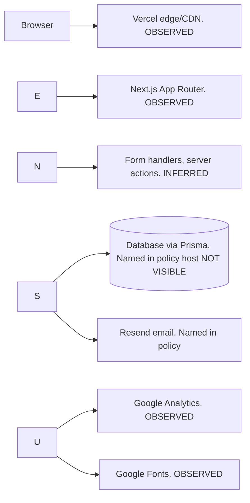

\# Backend Technical Audit: cynbit.in (

\## 1. Observed stack

| Item | Evidence Status |

|---|---|---|

Hosting/CDN | `server: Vercel` `x-vercel-cache: HIT` `x-vercel-id` | OBSERVED |

| Framework | `x-matched-path` `x-nextjs-prerender` `/\_next/` assets `next-size-adjust` meta | OBSERVED (Next.js App Router) |

| Protocol/compression | HTTP/2 `content-encoding: br` (curl with Accept-Encoding gzip, br) gzip in the securityheaders.com check | OBSERVED |

Email / DB | /privacy names Resend and Prisma; database host not disclosed | OBSERVED (named in policy); actual use INFERRED |

Analytics / fonts | gtag G-LK6CQWCWX0 Google Fonts; `\_ga` and `\_ga\_LK6...` cookies present on first load | OBSERVED |

| Forms | Contact, careers, newsletter; handlers look like Next.js server actions | INFERRED |

| API routes | Only named in robots.txt (`/api/` `/admin/` `/portal/`); none seen in public JS | NOT VISIBLE |

\## 2. Architecture

\## 3. HTTP behaviour (one request per URL)

\- Homepage returns status 200. The page includes headers such as `strict-transport-security: max-age=63072000` `cache-control: public, max-age=0, must-revalidate` and `access-control-allow-origin: \*`.

\- Redirects start at `http://cynbit.in` and go to `https://cynbit.in/` with a 308 status then to `https://www.cynbit.in/` with a 307 status. The final address `https://www.cynbit.in` serves a 200 status directly.

\- Missing security headers include CSP, X-Frame-Options, X-Content-Type-Options, Referrer-Policy and Permissions-Policy. The securityheaders.com rating is D.

\- The 404 page is custom. Does not reveal stack traces or file paths. It shows `x-matched-path` and `x-error-status` headers.

\- Evidence files can be found in the `evidence/` folder.

\## 4. Forms and data entry points ( HTML/JS only nothing submitted)

\- The Contact form collects `fullName` `email` `company` `industry` and `message`.

\- The Careers form asks for `fullName` `email` `phone` `whatsapp` `dob` `gender` ` `skills` `currentCity` `permanentAddress` `portfolioUrl` `linkedinUrl` an optional `profile URL` a `message` with a minimum length of ten characters a `terms` checkbox and multiple `education` rows.

\- The Newsletter form contains an `email` field placed in the global layout.

\- Client side validation uses HTML5 features only. Server side validation is not visible.

\- The Careers response handler reads `isDuplicate` and `trackingUrl`. When a duplicate is detected a tracking link is displayed.

\## 5. Performance

PageSpeed Insights was not finished so Core Web Vitals such as LCP CLS and TBT were not evaluated.

Without using tools we saw Brotli compression, HTTP/2 CDN cache HIT and that the homepage HTML is 100 KB in size (`content-length: 100498`).

\## 6. Not tested

We did not test server-side validation, rate limiting, firewall rules, authorization on tracking pages and `/admin` `/portal` paths, CORS and CSRF behaviour of form endpoints or any cookies, beyond the first-load list.

